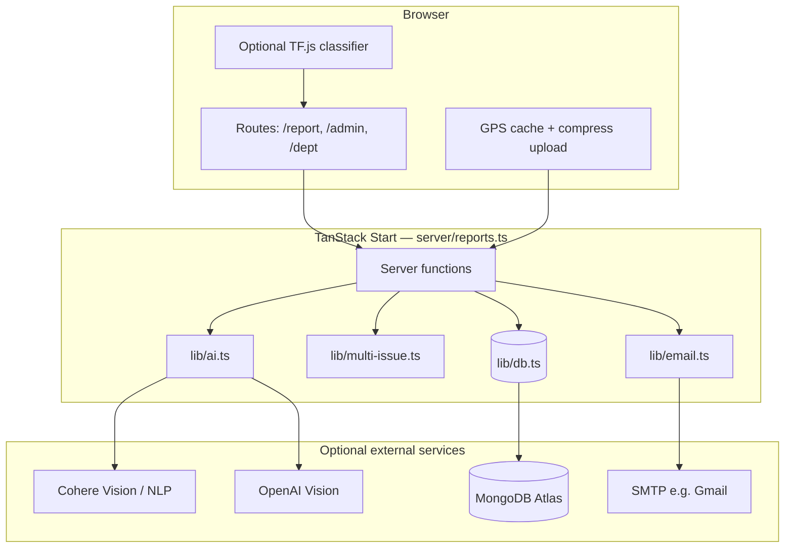

# CivicMind AI

**Multimodal AI for civic issue reporting, department routing, and municipal triage.**

Citizens report potholes, garbage pileups, and manhole defects with photos and GPS. The platform classifies issues with vision and NLP, supports **multi-issue detection** in a single photo, auto-routes confident tickets to departments, and queues ambiguous cases for **admin manual review**.

> 📄 **Extended documentation:** [docs/CivicMind-Full-Report.md](docs/CivicMind-Full-Report.md) (Markdown) · [docs/CivicMind-Full-Report.pdf](docs/CivicMind-Full-Report.pdf) (PDF)

---

## Table of contents

- [Overview](#overview)
- [Key features](#key-features)
- [Demo and screenshots](#demo-and-screenshots)
- [System architecture](#system-architecture)
- [Tech stack](#tech-stack)
- [Project structure](#project-structure)
- [Getting started](#getting-started)
- [Environment variables](#environment-variables)
- [Usage workflow](#usage-workflow)
- [Server API (TanStack server functions)](#server-api-tanstack-server-functions)
- [AI / ML methodology](#ai--ml-methodology)
- [Database design](#database-design)
- [Testing and scripts](#testing-and-scripts)
- [Results and evaluation](#results-and-evaluation)
- [Limitations and future work](#limitations-and-future-work)
- [Team and contributions](#team-and-contributions)
- [License](#license)
- [Acknowledgements](#acknowledgements)

---

## Overview

### Problem

Municipal complaint channels are often slow and inconsistent: citizens struggle to describe issues accurately, and staff must manually decide issue type and owning department (Public Works, Sanitation, Sewer Maintenance).

### Solution

CivicMind AI combines **photo classification**, optional **text analysis**, **GPS location**, and **rule-based routing** with confidence thresholds. When automation is uncertain—especially when multiple issue types appear in one image—tickets enter a **manual review queue** for administrators.

### Intended users

| Role | Purpose |
|------|---------|
| **Citizen** | Submit reports, view AI analysis, track tickets |
| **Administrator** | Analytics, manual review routing, global ticket management |
| **Department staff** | Department-scoped queues and status updates |

Authentication is username/password with role-based access (`citizen` vs `admin`).

---

## Key features

- **Automatic photo classification** — pothole, garbage pileup, manhole defect with per-class confidence scores (`perClassScores`).
- **Multi-issue detection** — surfaces all issue types above 8% confidence; auto-routes only when each detected type meets 24% (see thresholds below).
- **Photo-only or text-only reports** — minimum 10 characters for description-only; vision-only submissions skip NLP in scoring (NLP shown as N/A).
- **Weighted multimodal fusion** — `0.7 × vision + 0.3 × NLP` when both photo and description are present.
- **Manual review workflow** — admin reviews image, breakdown, and routes to the correct department.
- **Role-based portals** — `/report`, `/analysis`, `/admin`, `/dept`, `/reports/:id`.
- **Persistent tickets** — MongoDB Atlas when configured; local `data/store.json` fallback.
- **Department email notifications** — SMTP with local outbox fallback; async send on submit when auto-routed.
- **Optional local ML** — train MobileNet-style classifier (`ml/`) and run inference in browser or server.
- **Performance** — client image compression (max 1024px), classification cache on submit, memoized DB bootstrap, 15s AI request timeouts.

---

## Demo and screenshots

No demo URL or screenshot assets are checked into this repository.

**To capture screenshots for your submission:** run the app locally (`npm run dev`), sign in as citizen and admin, and photograph the Report, Vision Detection, Analysis, Admin Manual Review Queue, and Ticket Detail pages.

---

## System architecture



**Typical submit flow**

1. Citizen uploads photo → `classifyReportImage` (preview).
2. Citizen submits → `submitReport` reuses cached classification when fingerprint matches.
3. Scores fused → routing decision → ticket inserted → emails queued if auto-routed.

---

## Tech stack

| Layer | Technologies |
|--------|----------------|
| **Frontend** | React 19, TanStack Router, TanStack Query, Tailwind CSS 4, shadcn/ui, Lucide |
| **Backend** | TanStack Start server functions (`createServerFn`), Zod validation |
| **Database** | MongoDB (optional), JSON file store fallback |
| **AI / ML** | Cohere Vision/NLP, OpenAI Vision, TensorFlow.js local model, keyword heuristics |
| **Email** | Nodemailer (SMTP) |
| **Tooling** | Vite 7, TypeScript 5.9 |
| **Testing / ops scripts** | `tsx` scripts (Mongo, email, DB status); no automated test suite in repo |

---

## Project structure

```
ai-civic-/
├── routes/                 # Pages (/, /about, /report, /analysis, /login, /admin, /dept, /reports/:id)
├── components/civic/       # Report flow, admin dashboard, auth, login
├── components/ui/          # shadcn/ui primitives
├── server/reports.ts       # Server functions (submit, classify, auth, admin APIs)
├── lib/
│   ├── ai.ts               # Vision/NLP classification and analyzeReport
│   ├── multi-issue.ts      # Fusion, breakdown, routing summary
│   ├── db.ts               # Mongo + JSON persistence
│   ├── auth.ts             # Login and session tokens
│   ├── email.ts            # Department notifications
│   └── mongo.ts            # Atlas connection
├── ml/                     # Python training → TF.js export
├── public/models/          # Deployed TF.js classifier weights
├── public/uploads/         # Report images (gitignored)
├── env/                    # civicmind.config.example (secrets gitignored)
├── docs/                   # Full technical report (MD + PDF)
└── scripts/                # db-status, migrate, test-mongo, test-email, etc.
```

---

## Getting started

### Prerequisites

- **Node.js** 20+ (LTS recommended)
- **npm**
- Optional: **Python 3.10+** for training local classifier (`ml/`)
- Optional: **MongoDB Atlas** URI, **Cohere** and/or **OpenAI** API keys, **SMTP** credentials

### Installation

```bash
git clone https://github.com/shreyabadakundri/civic-issue-reporter.git
cd civic-issue-reporter   # or your local folder name
npm install
```

### Configuration

1. Copy the config template:
   ```bash
   cp env/civicmind.config.example env/civicmind.config
   ```
2. Edit `env/civicmind.config` with your placeholders (see [Environment variables](#environment-variables)).
3. Do **not** commit `env/civicmind.config` (it is gitignored).

The app loads secrets from `env/civicmind.config` via `lib/env.ts`.

### Run locally

```bash
npm run dev
```

Open **http://localhost:3000**

### Production build

```bash
npm run build
npm run start
```

---

## Environment variables

Configure in **`env/civicmind.config`** (see `env/civicmind.config.example`). Use placeholders only in documentation; never commit real secrets.

| Variable | Purpose |
|----------|---------|
| `AUTH_SESSION_SECRET` | HMAC secret for session tokens (required in production) |
| `AUTH_CITIZEN_USERNAME` / `AUTH_CITIZEN_PASSWORD` | Citizen login |
| `AUTH_ADMIN_USERNAME` / `AUTH_ADMIN_PASSWORD` | Admin login |
| `MONGODB_URL` | MongoDB connection string (optional) |
| `MONGODB_DB_NAME` | Database name (default `civicmind`) |
| `COHERE_API_KEY` | Cohere vision + NLP |
| `COHERE_VISION_MODEL` | e.g. `command-a-vision-07-2025` |
| `COHERE_NLP_MODEL` | e.g. `command-a-03-2025` |
| `OPENAI_API_KEY` | OpenAI vision fallback |
| `OPENAI_VISION_MODEL` | e.g. `gpt-4o-mini` |
| `SMTP_*` | Outbound email |
| `DEPT_EMAIL_*` | Department recipient addresses |

Without cloud keys, classification falls back to **local TF.js model** (if present) then **keyword heuristics**.

---

## Usage workflow

### Citizen

1. Open **/login** and sign in (citizen account).
2. Go to **/report** — allow location when prompted (cached up to 5 minutes).
3. Upload a photo and/or enter a description (≥10 characters if no photo).
4. Review **Vision Detection** (single or multiple issues with percentages).
5. Submit — view results on **/analysis** and ticket on **/reports/:id**.

### Administrator

1. Sign in as **admin**.
2. Open **/admin** — analytics, **Manual Review Queue**, all tickets, email outbox.
3. For manual review tickets: inspect image and breakdown → choose department → **Confirm & route**.

### Department

1. Sign in (citizen or admin, depending on your deployment policy).
2. Open **/dept** — filter by department queue; update ticket status.

### Ticket lifecycle

`submitted` → **`routed`** or **`manual_review`** → `in_progress` → `resolved` → `closed`

---

## Server API (TanStack server functions)

These are **not REST URLs**; they are invoked from the client via TanStack Start (`server/reports.ts`). Methods reflect server function configuration.

| Function | Method | Description |
|----------|--------|-------------|
| `authLogin` | POST | Username/password → session token + role |
| `verifyAuthSession` | GET | Validate token |
| `classifyReportImage` | POST | `FormData` with image → classification |
| `classifyReportDescription` | POST | Text → classification |
| `submitReport` | POST | `FormData` → create ticket + analysis |
| `fetchReport` | GET | Ticket + status history by id |
| `fetchReports` | GET | List/filter (admin or dept scoped) |
| `changeReportStatus` | POST | Update status |
| `adminRouteManualReview` | POST | Admin route from manual review |
| `getAdminAnalytics` | GET | Dashboard metrics (admin) |
| `getStats` / `getQueues` | GET | Platform stats / queues |
| `getEmailOutbox` | GET | Sent/queued emails (admin) |

Admin-protected calls require `authToken` from login.

---

## AI / ML methodology

### Issue classes

Three classes: **pothole**, **garbage**, **manhole**, mapped to departments in `lib/constants.ts` (`ISSUE_META`).

### Vision pipeline (priority order)

1. **Cohere Vision** — JSON with `issueType`, `confidence`, `perClassScores`, `reason`.
2. **OpenAI Vision** — same schema if Cohere unavailable.
3. **Local TF.js model** — `public/models/civic-classifier/` (train via `ml/train.py`).
4. **Heuristic** — keywords on filename/description (lowest accuracy).

Cloud requests use a **15 second timeout** (`AI_REQUEST_TIMEOUT_MS`).

### NLP

When description length ≥ 10 characters: Cohere NLP or keyword heuristic. Photo-only reports store **NLP score as 0** and use vision-only final score.

### Fusion and routing thresholds (from code)

| Constant | Value | Role |
|----------|-------|------|
| `ROUTING_THRESHOLD` | 0.45 | Single-issue auto-route |
| `MULTI_ISSUE_MIN_CONFIDENCE` | 0.24 | Each issue must meet this for auto multi-route |
| `ISSUE_CANDIDATE_MIN_CONFIDENCE` | 0.08 | Show/count as visible issue |
| `VISION_WEIGHT` / `NLP_WEIGHT` | 0.7 / 0.3 | Fusion when both modalities present |

### Training local model

See **`ml/README.md`**. Summary:

```bash
npm run ml:prepare
# Add images under ml/dataset/train|val/{pothole,garbage,manhole}/
cd ml && pip install -r requirements.txt && python train.py
npm run ml:export
npm run dev
```

### Limitations (model)

- Heuristic and filename-based fallback is not reliable for real photos.
- Multi-issue routing depends on model-calibrated `perClassScores`; weak scores trigger manual review by design.
- No published benchmark dataset or accuracy table is included in this repository.

---

## Database design

### Primary entity: `ReportRecord`

Stored in MongoDB collection `reports` or `data/store.json` → `reports[]`.

| Field | Description |
|-------|-------------|
| `id` | Ticket id e.g. `CIV-123456` |
| `issueType` | Primary type |
| `description`, `imagePath`, `lat`, `lng`, `locationLabel` | Submission payload |
| `visionScore`, `nlpScore`, `finalScore` | Analysis scores |
| `routed`, `status`, `department` | Routing outcome |
| `isMultiIssue`, `issueBreakdown[]` | Multi-issue metadata |
| `notifiedDepartments[]`, `lastStatusNote` | Comms / audit |
| `createdAt`, `updatedAt` | Timestamps |

### `statusHistory`

Per-ticket timeline: `reportId`, `status`, `note`, `createdAt`.

Mongo responses strip internal `_id` before sending to the client.

---

## Testing and scripts

There is **no** Jest/Vitest/Playwright suite in this repository. Verified helper scripts:

| Command | Purpose |
|---------|---------|
| `npm run test:mongo` | Test MongoDB connection |
| `npm run test:email` | Test SMTP / outbox |
| `npm run db:status` | Compare local JSON vs Atlas counts |
| `npm run db:migrate` | Migrate local store to MongoDB |
| `npx tsx scripts/bench-submit-parts.ts` | Partial server-side classification timing (optional) |

**Test status:** Automated pass/fail CI is **not configured** (no `.github/workflows` found).

---

## Results and evaluation

- **Routing thresholds** are defined in code (`lib/constants.ts`, `lib/multi-issue.ts`), not learned from a labeled production dataset in-repo.
- Optional dev script `scripts/bench-submit-parts.ts` logs partial timings (e.g. DB bootstrap, one vision call); full submit timings appear as `[submitReport]` lines in the **server console** during development.
- No verified accuracy percentages, latency SLAs, or user-study results are committed to this repository—do not cite numbers unless you measure them in your own deployment.

---

## Limitations and future work

**Current limitations**

- No mobile native app; web-only.
- Auth is env-based username/password (not OAuth/SSO).
- Email delivery depends on SMTP configuration; otherwise outbox-only.
- Department portal shares broad auth model with citizens unless customized.
- Large model weights in `public/models/` increase clone size.

**Possible improvements**

- CI/CD, automated tests, and staging deployment docs.
- Reverse geocoding for human-readable addresses (non-blocking).
- Multi-department routing from manual review in one action.
- Additional issue classes and departments.
- Public demo deployment with sanitized data.

---

## Team and contributions

| Contributor | Role |
|-------------|------|
| **Shreya Badakundri** | Repository maintainer ([GitHub](https://github.com/shreyabadakundri)) |

_Add other team members, roles, and contributions here if applicable for your college/hackathon submission._

Contributions via pull requests are welcome once contribution guidelines are defined.

---

## License

No `LICENSE` file is present in this repository at the time of this README. **License TBD** — add MIT, Apache-2.0, or your institution’s required license before public release.

---

## Acknowledgements

- [TanStack Start](https://tanstack.com/start) & [TanStack Router](https://tanstack.com/router)
- [shadcn/ui](https://ui.shadcn.com/) and [Radix UI](https://www.radix-ui.com/)
- [Cohere](https://cohere.com/) and [OpenAI](https://openai.com/) APIs (optional)
- [MongoDB Atlas](https://www.mongodb.com/atlas) (optional)
- [TensorFlow.js](https://www.tensorflow.org/js) for browser/local inference
- UI icons: [Lucide](https://lucide.dev/)

---

### Quick reference — install and run

```bash
npm install
cp env/civicmind.config.example env/civicmind.config
# Edit env/civicmind.config with YOUR_API_KEY, YOUR_DATABASE_URI, etc.
npm run dev
```

**Default dev logins** (only when `AUTH_*` vars are unset in config): see `env/civicmind.config.example` — change these before any public deployment.
